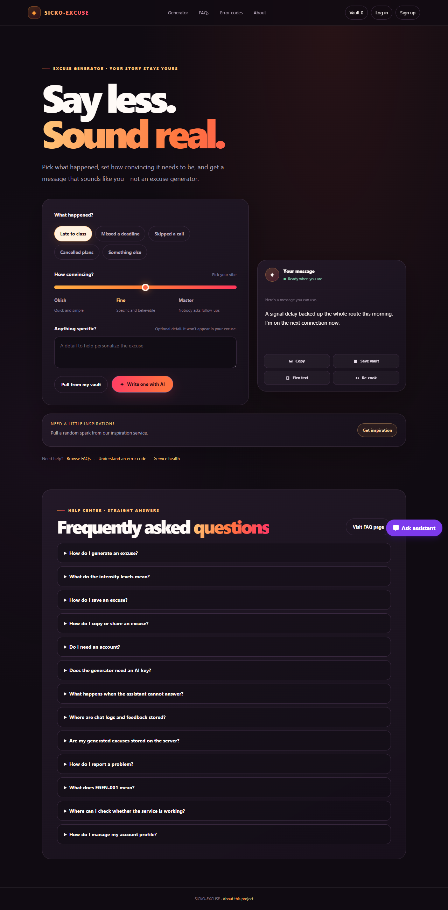
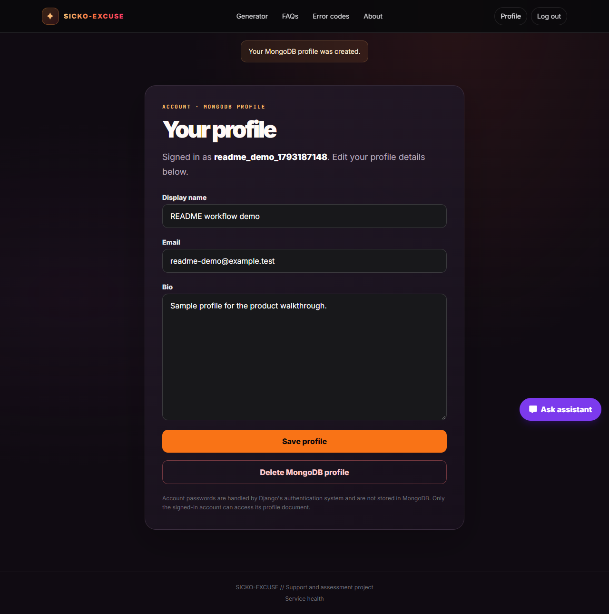
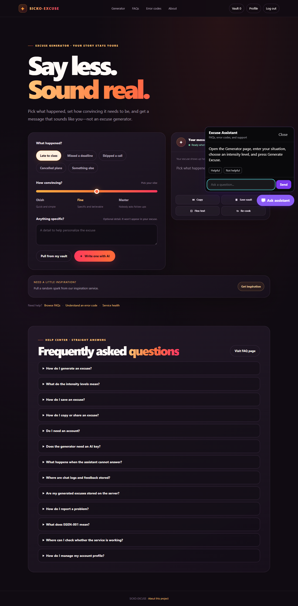
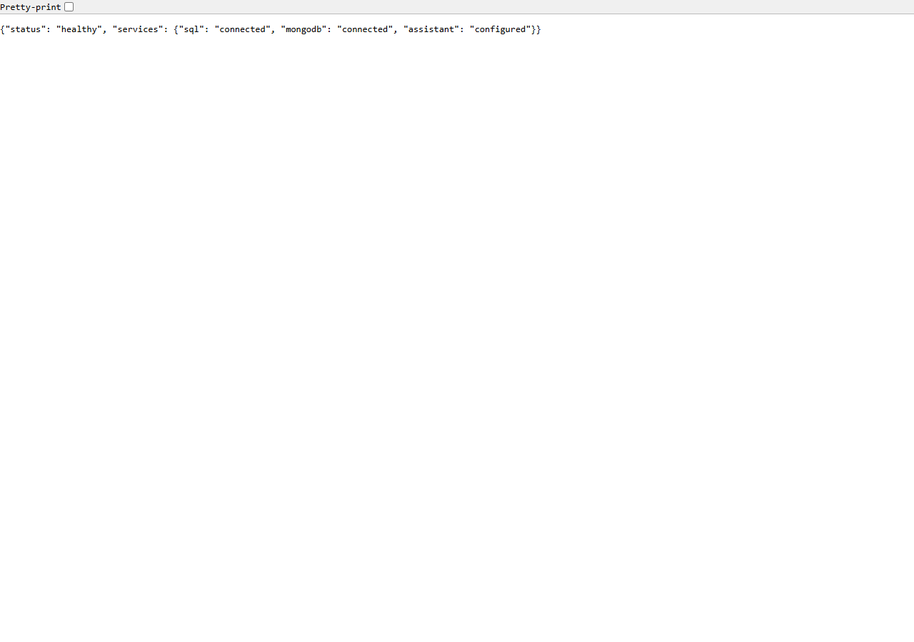

# Sicko-Excuse

A responsive excuse generator with a support assistant grounded in the site's FAQ and error-code guide.

[Open the live app](https://excuse-generator-forge.vercel.app/) · [GitHub repository](https://github.com/Dhakshinesh-designs/excuse-generator) · [Assessment brief](https://docs.google.com/spreadsheets/d/1gac3qN_sFgbBQR7utv6N-66-C8szNq3-F6L7NQsbx78/edit?usp=sharing)

## Product tour

The following screenshots and recording show the live application workflow.

| Excuse generator | Account profile |
| --- | --- |
|  |  |

| Support assistant | Service health |
| --- | --- |
|  |  |

[Watch the full workflow recording](docs/media/workflow.webm)

## Features

- Generate a message from a situation and tone; private notes are not included in the generated text.
- Browse thirteen FAQs and explanations for common HTTP errors, including the site's `EGEN-001` code.
- Ask the support assistant questions answered from the site's SQL FAQ/error data, with optional Gemini-generated grounded responses.
- Create an account with Django's password hashing. Account credentials stay in SQL; MongoDB never receives passwords.
- Create, view, update, and delete an account-scoped MongoDB profile.
- Persist assistant chat exchanges and feedback in MongoDB when configured.
- Create support tickets in SQL when the assistant cannot answer; associate tickets with signed-in users and manage them in Django admin.
- Check SQL, MongoDB, and assistant configuration through `/health/`.
- Get a random inspiration prompt, with a local fallback if the external service is unavailable.

## Technology

- Python 3.12+
- Django 6.1
- SQLite for Django relational data
- MongoDB Atlas with PyMongo for profiles, chat history, and feedback
- Optional Gemini API for FAQ-grounded assistant responses
- WhiteNoise for local static-file serving; Vercel serves collected assets through its CDN
- Vercel Python runtime; dependencies are declared in `requirements.txt` and installed with Vercel's `uv`-based build

## Run locally

```powershell
python -m venv .venv
.\.venv\Scripts\Activate.ps1
python -m pip install -r requirements.txt
Copy-Item .env.example .env
python manage.py migrate
python manage.py runserver
```

Open <http://127.0.0.1:8000/>. The site and FAQ assistant work without MongoDB or Gemini. MongoDB profile, chat, and feedback persistence requires `MONGODB_URI`; Gemini-generated responses require `GEMINI_API_KEY`. The local `.env` is ignored by Git.

## Configuration

Set local values in `.env`. For Vercel, add them in **Project Settings → Environment Variables** and redeploy. Never commit or share secret values.

| Variable | Required | Purpose |
| --- | --- | --- |
| `DJANGO_SECRET_KEY` | Yes in production | Unique, private Django signing key. Never use the example or development key in production. |
| `DJANGO_DEBUG` | Recommended | Keep `False` in production. |
| `DJANGO_ALLOWED_HOSTS` | Yes in production | Comma-separated hostnames, such as `.vercel.app`. Do not include a scheme or path. |
| `DJANGO_CSRF_TRUSTED_ORIGINS` | For HTTPS form submissions | Comma-separated full origins, such as `https://your-app.vercel.app`. |
| `DJANGO_SECURE_SSL_REDIRECT` | Recommended on HTTPS | Set to `True` when the host terminates HTTPS. |
| `DJANGO_SECURE_HSTS_SECONDS` | Optional | Enable HSTS only after verifying HTTPS for the deployed domain. |
| `DJANGO_SECURE_HSTS_INCLUDE_SUBDOMAINS` | Optional | Include subdomains only when every subdomain supports HTTPS. |
| `DJANGO_SECURE_HSTS_PRELOAD` | Optional | Use only after reviewing the permanent browser preload requirements. |
| `MONGODB_URI` | Optional | MongoDB Atlas connection URI for profiles, chat, and feedback. URL-encode special characters in credentials. |
| `MONGODB_DATABASE` | Optional | MongoDB database name; defaults to `excuse_generator`. |
| `GEMINI_API_KEY` | Optional | Server-side key for generated assistant responses. Without it, FAQ matching remains available. |

### MongoDB Atlas

1. Create a MongoDB Atlas cluster and a database user with a strong password.
2. Configure Atlas Network Access to permit connections from your hosting environment.
3. Copy the Python driver connection URI and replace its password placeholder. URL-encode special characters.
4. Set `MONGODB_URI` and `MONGODB_DATABASE` locally and in Vercel as needed.

The app uses the `user_profiles`, `chat_logs`, and `feedback` collections. Account passwords are stored only as Django password hashes in the SQL database.

## Database and hosting notes

The app uses SQLite for accounts, FAQs, error codes, sessions, and support tickets. It needs no SQL provider or SQL connection-string variable.

**SQLite on Vercel is temporary and instance-local.** The app stores the database under the function's temporary directory and runs Django migrations when a function instance starts. Vercel may discard that storage on a cold start or redeploy, and multiple function instances do not share the same database. As a result, accounts, sessions, FAQs, and tickets can disappear or differ between requests. This setup is suitable only when that data-loss and consistency trade-off is acceptable; it is not durable production storage.

Vercel automatically detects the Django project from `manage.py`, serves the WSGI application at `myproject.wsgi:application`, and collects static files from `STATIC_ROOT`. Python dependencies are read from `requirements.txt`; a `uv.lock` or `pyproject.toml` is not required.

## Routes

| Path | Description |
| --- | --- |
| `/` | Excuse generator, inspiration, and FAQ preview |
| `/faq/` | FAQ directory |
| `/errors/` | HTTP and application error-code guide |
| `/about/` | Project information |
| `/accounts/register/` | Create an account |
| `/accounts/login/` | Sign in |
| `/accounts/profile/` | Manage the signed-in user's MongoDB profile |
| `/health/` | SQL, MongoDB, and assistant health status |
| `/api/assistant/` | FAQ/error assistant and support-ticket creation |
| `/api/assistant/feedback/` | Save assistant feedback to MongoDB |
| `/api/inspiration/` | Fetch inspiration with local fallback |

Custom 404 and 500 pages are enabled when `DJANGO_DEBUG=False`.

## Deployment checklist

1. Import the GitHub repository into Vercel and deploy the `main` branch.
2. Add a unique `DJANGO_SECRET_KEY`, `DJANGO_ALLOWED_HOSTS`, and the HTTPS origin in `DJANGO_CSRF_TRUSTED_ORIGINS`. Keep `DJANGO_DEBUG=False` and enable `DJANGO_SECURE_SSL_REDIRECT=True` for the HTTPS deployment.
3. Add `MONGODB_URI` and `MONGODB_DATABASE` to enable persistent MongoDB features. Add `GEMINI_API_KEY` only if generated assistant answers are wanted.
4. Redeploy after changing environment variables.
5. Check `/health/`, register an account, save a profile, generate an excuse, and send an assistant message. Remember that SQLite data on Vercel is temporary and not shared across instances.

## Development checks

```powershell
python manage.py check
python manage.py makemigrations --check --dry-run
python manage.py test
python manage.py collectstatic --noinput
```

## Security

- Keep `.env`, MongoDB credentials, Django signing keys, and API keys out of Git and screenshots.
- Rotate any credential that has been exposed.
- Use a unique production `DJANGO_SECRET_KEY` and least-privilege database credentials.
